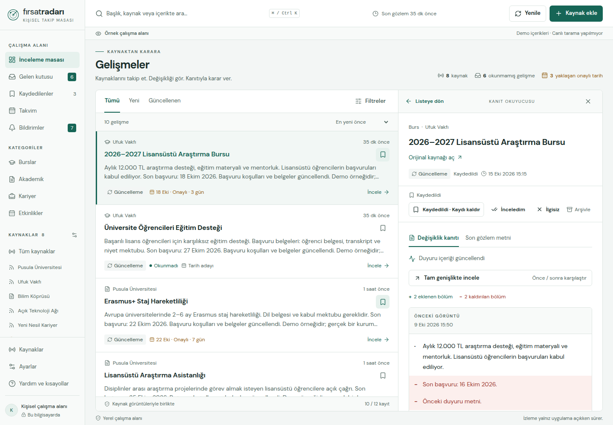
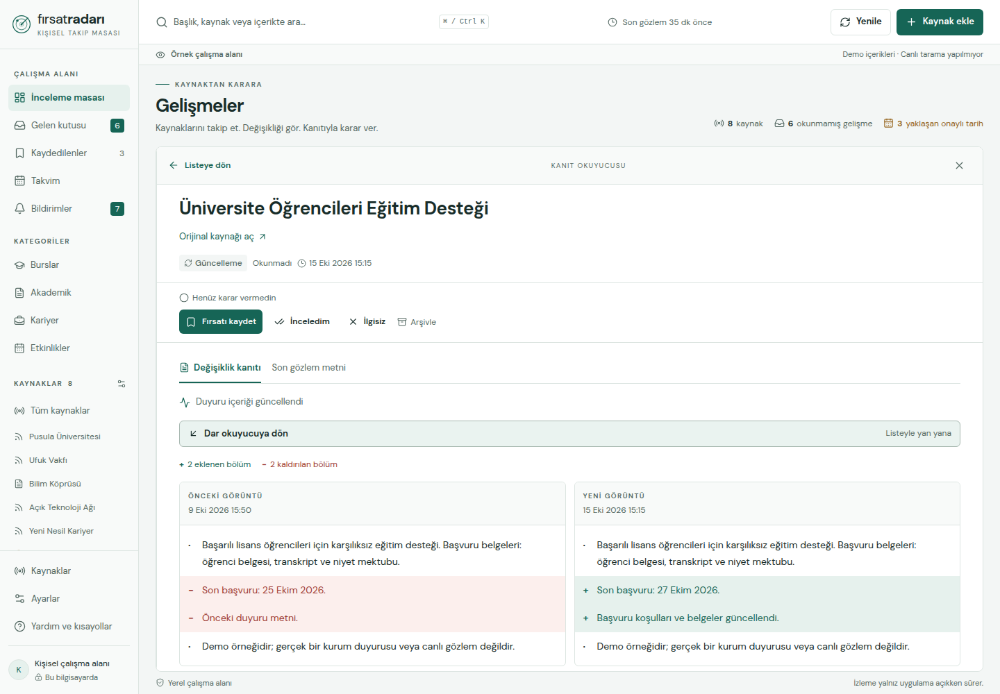
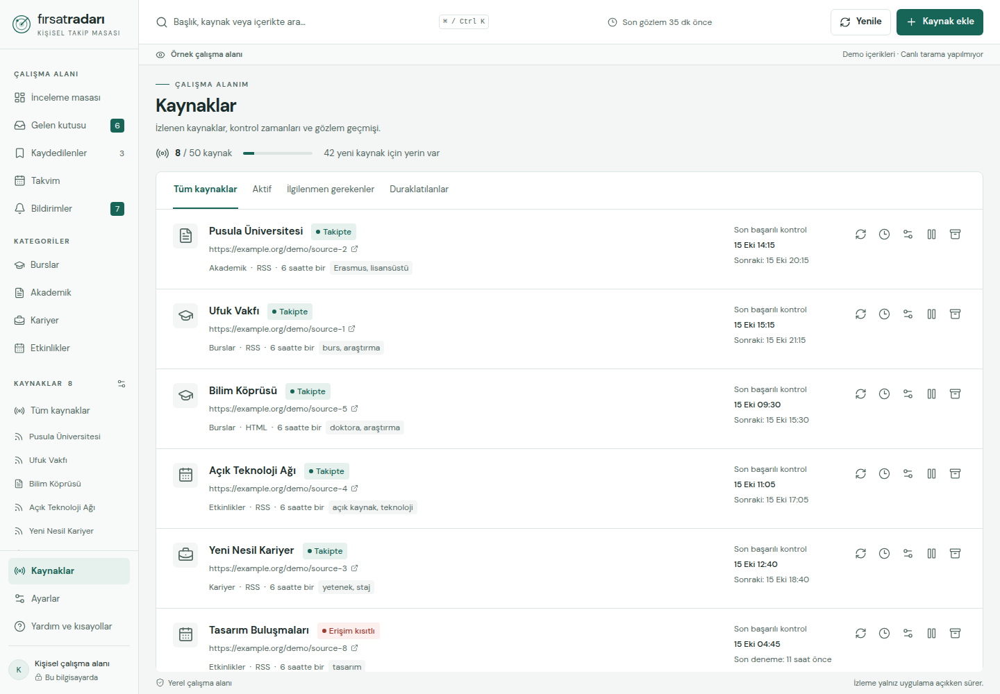
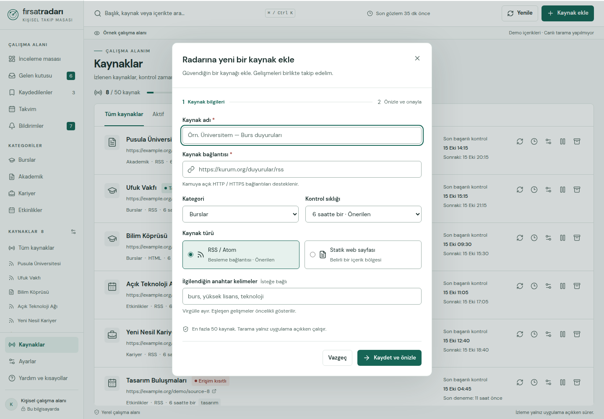
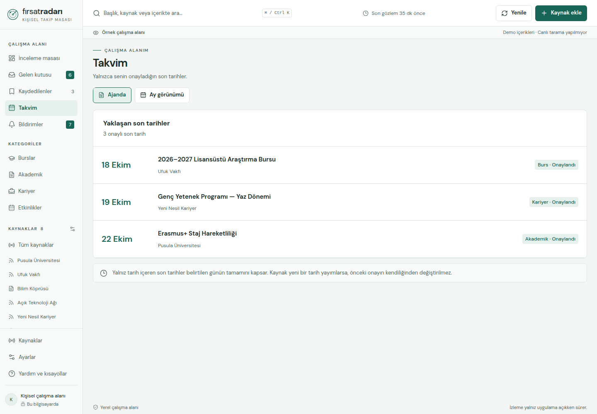

**English** · [Türkçe](README.tr.md)

<div align="center">

# Fırsat Radarı

**A local app that watches RSS/Atom feeds and static HTML regions and shows every change together with its previous state.**


[Highlights](#highlights) · [Screenshots](#screenshots) · [Setup](#setup-and-running) · [Tests](#tests) · [Documentation](#documentation)



</div>

Fırsat Radarı (Opportunity Radar) watches public RSS/Atom feeds and the static HTML regions you choose, and shows a meaningful change side by side with its previous snapshot. It was designed for students, new graduates and career advisors who follow scholarship, career and event announcements. It is single-user and runs only on your own computer. It is written in TypeScript: Express 5 and SQLite (better-sqlite3, Drizzle) on the back end, React 19 and Vite on the front end.

The user interface is in Turkish. The detailed documents under `docs/` are in Turkish.

## Highlights

- **Source types:** RSS/Atom feeds and static HTML regions selected with a CSS selector are watched.
- **Diff with evidence:** every change opens with the previous and the new snapshot, with added and removed parts marked.
- **Baseline approval:** the first snapshot is previewed and approved, and produces no notification. When the selector changes, a new baseline is required.
- **Decision flow:** the decisions İnceledim (Reviewed), Kaydet (Save), İlgisiz (Not relevant) and Arşivle (Archive) are stored together with their evidence.
- **Confirmed deadlines:** date candidates extracted from the source do not enter the calendar or the reminders until you confirm them.
- **Safe fetching:** only HTTP/HTTPS and ports 80/443. Private, loopback and metadata addresses are blocked, and the connection is pinned to the validated IP.
- **Politeness limits:** one concurrent request per host and at least 10 seconds between requests. robots, crawl-delay and Retry-After are applied.
- **Persistent queue:** manual and scheduled checks use the same SQLite queue. The reason for a wait is shown in the interface.
- **Local session:** the server listens only on `127.0.0.1`. Pairing with a one-time code shown in the terminal, an HttpOnly cookie and a CSRF check.
- **Backup:** a consistent backup is taken from the running database. Integrity and schema are checked before a restore.
- **Demo mode:** opens in a separate data directory with 8 sample sources and 12 opportunities. It does not mix with the normal database.

Details: [docs/KULLANIM.md](docs/KULLANIM.md) and [docs/YAPILANDIRMA.md](docs/YAPILANDIRMA.md)

## Screenshots

<table>
  <tr>
    <td width="50%"></td>
    <td width="50%"></td>
  </tr>
  <tr>
    <td align="center">Evidence reader, full width: previous and new snapshot side by side</td>
    <td align="center">Sources: status, last successful check and next check time</td>
  </tr>
  <tr>
    <td width="50%"></td>
    <td width="50%"></td>
  </tr>
  <tr>
    <td align="center">Adding a source: RSS/Atom or a static web page</td>
    <td align="center">Calendar: confirmed deadlines only</td>
  </tr>
</table>

The large image at the top: the update list and the open evidence reader on the review desk. The screenshots were taken with demo data; the institution names and announcements are examples. The 768 and 390 px screenshots and the previous design are under [artifacts/frontend-redesign](artifacts/frontend-redesign/).

## Requirements

- Node.js 22.12 or later and npm. Development was done on Node 24.19.0 / npm 11.17.0 / Ubuntu 26.04.1.
- Linux. The npm scripts set environment variables with POSIX syntax (`FR_DEMO=1 npm run dev`).
- C++ build tools and Python, if there is no prebuilt `better-sqlite3` binary for the platform.
- Chrome or Chromium on the system for the browser tests (if missing, `npx playwright install chromium`).

## Setup and running

Run the commands in the project root.

```bash
npm ci
npm run demo
```

Open `http://127.0.0.1:5173` in the browser. The demo opens with sample data in the `.local/demo` directory and does not scan automatically.

For an empty workspace with your own sources:

```bash
npm run dev
```

Open the same address and enter the pairing code shown in the terminal. The code is single-use and valid for 10 minutes.

The production build serves the front end and the API from one address (`http://127.0.0.1:4318`):

```bash
npm run build
npm start
```

The environment variables (`FR_PORT`, `FR_DATA_DIR`, `FR_DEMO`) are documented in [.env.example](.env.example). For the data directory, permissions and the built demo: [docs/YAPILANDIRMA.md](docs/YAPILANDIRMA.md)

## How it works

1. A source is added: an RSS/Atom address, or an HTML page and the CSS selector of the region to watch.
2. A preview is taken and the baseline snapshot is approved.
3. The scheduler checks the source every 6 hours by default (30 minutes at the shortest). A manual check enters the same queue.
4. The new snapshot is compared with the previous one. If there is a difference, an update and a notification are created.
5. The evidence is reviewed, a decision is made and the deadline, if any, is confirmed.

Up to 50 sources can be added. 30 snapshots or 90 days are kept per source; evidence tied to a decision is kept in a separate 100 MiB quota. Step-by-step guide, backup and troubleshooting: [docs/KULLANIM.md](docs/KULLANIM.md)

## Architecture

- **`apps/server`:** Express API. Session, source, observation, decision and notification services; a safe HTTP adapter; a persistent job queue on SQLite.
- **`apps/web`:** React front end. Data comes from the API through TanStack Query; dialogs use Radix, styles use Tailwind CSS and design tokens.
- **`packages/shared`:** Zod contracts, and normalization, diff and date rules that are independent of HTTP and the front end.

In development, Vite forwards `/api` requests to the server on port 4318. Design decisions: [docs/DECISIONS.md](docs/DECISIONS.md)

## API summary

| Endpoint | Purpose |
|---|---|
| `POST /api/pair`, `POST /api/logout` | Pairing with the terminal code, and logout |
| `GET` / `POST /api/sources` | List and add sources |
| `POST /api/sources/:id/preview`, `/baseline`, `/check` | Preview, baseline approval, manual check |
| `GET /api/items`, `GET /api/items/:id/diff` | Update list and before/after diff |
| `POST /api/items/:id/decisions`, `/deadline-confirmations` | Decision and deadline confirmation |
| `GET /api/notifications`, `GET /api/settings` | Notifications and working preferences |
| `POST /api/backups`, `POST /api/restore` | Take a backup and restore |

All endpoints are defined in `apps/server/src/app.ts`.

## Folder structure

```
apps/
  server/src/     Express application: auth, db, jobs, modules, network, storage
  server/drizzle/ SQL migration
  web/src/        React front end: components, features, lib, styles
packages/
  shared/src/     contracts, normalization, diff and date rules
tests/
  unit/           unit tests
  ui/             React tests on jsdom
  integration/    API tests with Express and SQLite
  e2e/            Playwright scenarios and test server
  bench/          measurement script for the list and diff endpoints
scripts/          license inventory script
artifacts/        screenshots, measurement and license outputs
docs/             plan, decisions, test and performance reports
```

## Tests

```bash
npm run typecheck
npm run lint
npm test
npm run test:integration
npm run test:e2e
npm run bench
```

`npm test` runs the unit and UI tests. `npm run test:integration` runs the Express and SQLite boundaries. `npm run test:e2e` builds first, then uses Playwright to start test servers with temporary databases on ports 4329 and 4330. In the last recorded run, 26 unit/UI, 64 integration and 9 browser tests passed. Conditions: [docs/TESTLER.md](docs/TESTLER.md), results: [docs/TEST-REPORT.md](docs/TEST-REPORT.md)

## Known gaps

- No validation against live institutional sources and no user pilot has been done. The tests run on controlled sample data.
- Content rendered by JavaScript and pages behind a login, CAPTCHA or paywall are not watched.
- Watching does not continue while the app or the computer is off. The observation gap is shown at startup.
- The SQLite data and the backups are not encrypted.
- There is no current `npm audit` result. The previous attempt ended with a registry DNS error.

Open acceptance steps: [docs/TEST-REPORT.md](docs/TEST-REPORT.md#açık-kabul-adımları)

## Documentation

- [Usage](docs/KULLANIM.md): first flow, backup, troubleshooting.
- [Configuration and limits](docs/YAPILANDIRMA.md): data directory, environment variables, watch limits.
- [Tests](docs/TESTLER.md), [test report](docs/TEST-REPORT.md) and [performance measurement](docs/PERFORMANCE.md).
- [Plan](docs/PLAN.md), [architecture decisions](docs/DECISIONS.md), [product and pilot definition](docs/PRODUCT.md), [progress](docs/PROGRESS.md).
- [Front-end redesign report](docs/FRONTEND-REDESIGN.md) and [dependency licenses](docs/LICENSES.md).

## License

The code is released under the [MIT license](LICENSE). Third-party notices: [docs/THIRD-PARTY-NOTICES.txt](docs/THIRD-PARTY-NOTICES.txt)
