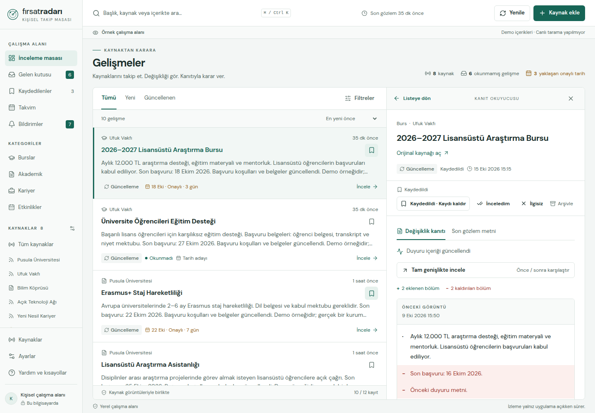
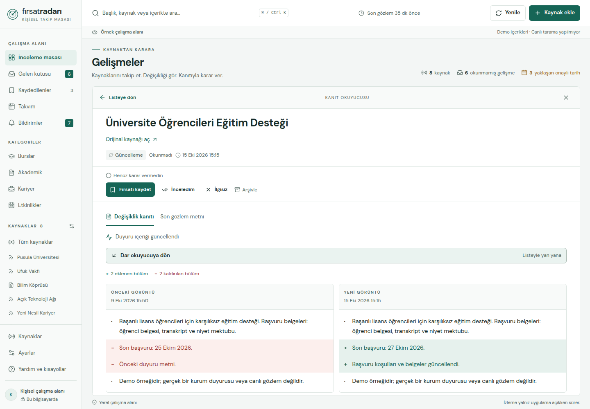
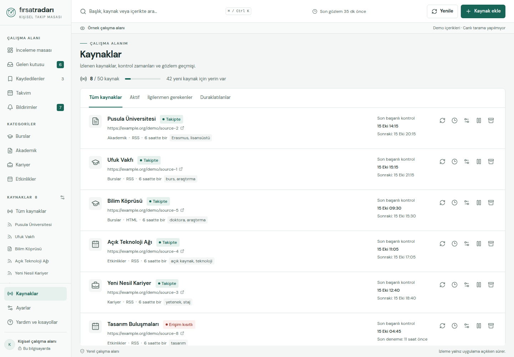
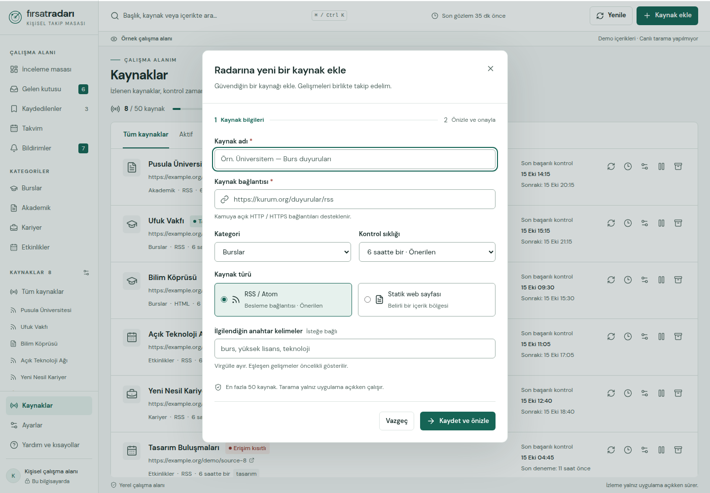
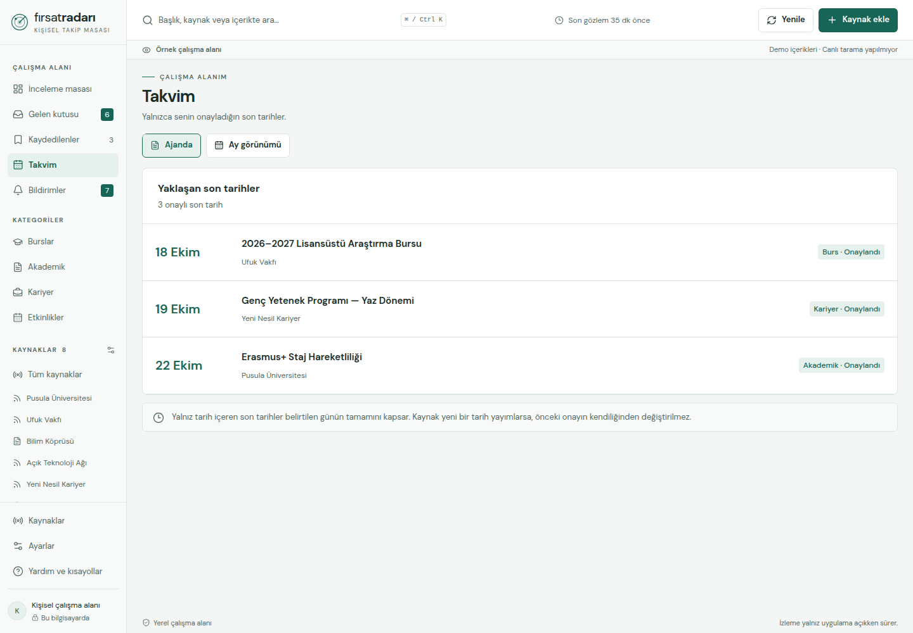

[English](README.md) · **Türkçe**

<div align="center">

# Fırsat Radarı

**RSS/Atom beslemelerini ve statik HTML bölgelerini izleyen, her değişikliği önceki haliyle birlikte gösteren yerel uygulama.**


[Öne çıkanlar](#öne-çıkanlar) · [Ekran görüntüleri](#ekran-görüntüleri) · [Kurulum](#kurulum-ve-çalıştırma) · [Testler](#testler) · [Belgeler](#belgeler)



</div>

Fırsat Radarı, kamuya açık RSS/Atom beslemelerini ve seçtiğiniz statik HTML bölgelerini izler; anlamlı değişikliği önceki görüntüsüyle yan yana gösterir. Burs, kariyer ve etkinlik duyurularını takip eden öğrenciler, yeni mezunlar ve kariyer danışmanları için tasarlandı; tek kullanıcılıdır ve yalnız kendi bilgisayarınızda çalışır. TypeScript ile yazıldı: sunucu tarafında Express 5 ve SQLite (better-sqlite3, Drizzle), arayüzde React 19 ve Vite.

## Öne çıkanlar

- **Kaynak türleri:** RSS/Atom beslemeleri ve CSS seçicisiyle belirlenen statik HTML bölgeleri izlenir.
- **Kanıtlı fark:** her değişiklik önceki ve yeni görüntüyle, eklenen ve kaldırılan bölümler işaretli olarak açılır.
- **Başlangıç onayı:** ilk görüntü önizlenip onaylanır ve bildirim üretmez; seçici değişince yeni başlangıç istenir.
- **Karar akışı:** İnceledim, Kaydet, İlgisiz ve Arşivle kararları kanıtıyla birlikte saklanır.
- **Onaylı son tarihler:** kaynaktan çıkarılan tarih adayları siz onaylamadan takvime ve hatırlatmaya girmez.
- **Güvenli toplama:** yalnız HTTP/HTTPS ve 80/443 portları; özel, loopback ve metadata adresleri engellenir, bağlantı doğrulanan IP'ye sabitlenir.
- **Nezaket sınırları:** host başına tek eşzamanlı istek ve en az 10 saniye ara; robots, crawl-delay ve Retry-After uygulanır.
- **Kalıcı kuyruk:** elle ve zamanlanmış kontroller aynı SQLite kuyruğunu kullanır; bekleme nedeni arayüzde görünür.
- **Yerel oturum:** sunucu yalnız `127.0.0.1` üzerinde dinler; terminalde gösterilen tek kullanımlık kodla eşleştirme, HttpOnly cookie ve CSRF denetimi.
- **Yedekleme:** çalışan veritabanından tutarlı yedek alınır; geri yükleme öncesi bütünlük ve şema denetlenir.
- **Demo modu:** ayrı veri dizininde 8 örnek kaynak ve 12 fırsatla açılır; normal veritabanına karışmaz.

Ayrıntılar: [docs/KULLANIM.md](docs/KULLANIM.md) ve [docs/YAPILANDIRMA.md](docs/YAPILANDIRMA.md)

## Ekran görüntüleri

<table>
  <tr>
    <td width="50%"></td>
    <td width="50%"></td>
  </tr>
  <tr>
    <td align="center">Kanıt okuyucusu, tam genişlik: önceki ve yeni görüntü yan yana</td>
    <td align="center">Kaynaklar: durum, son başarılı kontrol ve sonraki kontrol zamanı</td>
  </tr>
  <tr>
    <td width="50%"></td>
    <td width="50%"></td>
  </tr>
  <tr>
    <td align="center">Kaynak ekleme: RSS/Atom ya da statik web sayfası</td>
    <td align="center">Takvim: yalnız onaylanmış son tarihler</td>
  </tr>
</table>

Üstteki büyük görsel: inceleme masasında gelişme listesi ve açık kanıt okuyucusu. Görüntüler demo verisiyle alındı; kurum adları ve duyurular örnektir. 768 ve 390 px görüntüleri ile önceki tasarım [artifacts/frontend-redesign](artifacts/frontend-redesign/) altındadır.

## Gereksinimler

- Node.js 22.12 veya üstü ve npm. Geliştirme Node 24.19.0 / npm 11.17.0 / Ubuntu 26.04.1 üzerinde yapıldı.
- Linux. npm betikleri ortam değişkenlerini POSIX sözdizimiyle verir (`FR_DEMO=1 npm run dev`).
- `better-sqlite3` için platformda hazır binary yoksa C++ derleme araçları ve Python.
- Tarayıcı testleri için sistemde Chrome ya da Chromium (yoksa `npx playwright install chromium`).

## Kurulum ve çalıştırma

Komutları proje kökünde çalıştırın.

```bash
npm ci
npm run demo
```

Tarayıcıda `http://127.0.0.1:5173` adresini açın. Demo, `.local/demo` dizininde örnek verilerle açılır ve otomatik tarama yapmaz.

Kendi kaynaklarınızla boş bir çalışma alanı için:

```bash
npm run dev
```

Aynı adresi açın ve terminalde gösterilen eşleştirme kodunu girin. Kod tek kullanımlıktır ve 10 dakika geçerlidir.

Production derlemesi arayüzü ve API'yi tek adresten (`http://127.0.0.1:4318`) sunar:

```bash
npm run build
npm start
```

Ortam değişkenleri (`FR_PORT`, `FR_DATA_DIR`, `FR_DEMO`) [.env.example](.env.example) içinde belgelenir. Veri dizini, izinler ve derlenmiş demo için: [docs/YAPILANDIRMA.md](docs/YAPILANDIRMA.md)

## Nasıl çalışır

1. Kaynak eklenir: RSS/Atom adresi ya da bir HTML sayfası ve izlenecek bölgenin CSS seçicisi.
2. Önizleme alınır ve başlangıç görüntüsü onaylanır.
3. Zamanlayıcı kaynağı varsayılan 6 saatte bir (en kısa 30 dakika) kontrol eder; elle kontrol aynı kuyruğa girer.
4. Yeni görüntü öncekiyle karşılaştırılır; fark varsa gelişme ve bildirim oluşur.
5. Kanıt incelenir, karar verilir ve varsa son tarih onaylanır.

En fazla 50 kaynak eklenebilir. Kaynak başına 30 görüntü ya da 90 gün saklanır; karara bağlı kanıt ayrı 100 MiB kotada korunur. Adım adım anlatım, yedekleme ve sorun giderme: [docs/KULLANIM.md](docs/KULLANIM.md)

## Mimari

- **`apps/server`:** Express API. Oturum, kaynak, gözlem, karar ve bildirim servisleri; güvenli HTTP adaptörü; SQLite üzerinde kalıcı iş kuyruğu.
- **`apps/web`:** React arayüzü. Veri TanStack Query ile API'den gelir; diyaloglar Radix, stiller Tailwind CSS ve tasarım değişkenleri.
- **`packages/shared`:** Zod sözleşmeleri ile HTTP ve arayüzden bağımsız normalizasyon, fark ve tarih kuralları.

Geliştirmede Vite `/api` isteklerini 4318 portundaki sunucuya yönlendirir. Tasarım kararları: [docs/DECISIONS.md](docs/DECISIONS.md)

## API özeti

| Uç | İşlev |
|---|---|
| `POST /api/pair`, `POST /api/logout` | Terminal koduyla eşleştirme ve çıkış |
| `GET` / `POST /api/sources` | Kaynakları listeleme ve ekleme |
| `POST /api/sources/:id/preview`, `/baseline`, `/check` | Önizleme, başlangıç onayı, elle kontrol |
| `GET /api/items`, `GET /api/items/:id/diff` | Gelişme listesi ve önce/sonra farkı |
| `POST /api/items/:id/decisions`, `/deadline-confirmations` | Karar ve son tarih onayı |
| `GET /api/notifications`, `GET /api/settings` | Bildirimler ve çalışma tercihleri |
| `POST /api/backups`, `POST /api/restore` | Yedek alma ve geri yükleme |

Tüm uçlar `apps/server/src/app.ts` içinde tanımlıdır.

## Klasör yapısı

```
apps/
  server/src/     Express uygulaması: auth, db, jobs, modules, network, storage
  server/drizzle/ SQL migration
  web/src/        React arayüzü: components, features, lib, styles
packages/
  shared/src/     sözleşmeler, normalizasyon, fark ve tarih kuralları
tests/
  unit/           birim testleri
  ui/             jsdom üzerinde React testleri
  integration/    Express ve SQLite ile API testleri
  e2e/            Playwright senaryoları ve test sunucusu
  bench/          liste ve fark uçları için ölçüm betiği
scripts/          lisans envanteri betiği
artifacts/        ekran görüntüleri, ölçüm ve lisans çıktıları
docs/             plan, kararlar, test ve performans raporları
```

## Testler

```bash
npm run typecheck
npm run lint
npm test
npm run test:integration
npm run test:e2e
npm run bench
```

`npm test` birim ve arayüz testlerini, `npm run test:integration` Express ve SQLite sınırlarını çalıştırır. `npm run test:e2e` önce derleme yapar, sonra Playwright ile 4329 ve 4330 portlarında geçici veritabanlı test sunucularını açar. Son kayıtlı çalıştırmada 26 birim/arayüz, 64 entegrasyon ve 9 tarayıcı testi geçti. Koşullar: [docs/TESTLER.md](docs/TESTLER.md), sonuçlar: [docs/TEST-REPORT.md](docs/TEST-REPORT.md)

## Bilinen eksikler

- Canlı kurum kaynaklarıyla doğrulama ve kullanıcı pilotu yapılmadı; testler kontrollü örnek veriyle çalışır.
- JavaScript ile oluşan içerik ve giriş, CAPTCHA ya da ücret duvarı arkasındaki sayfalar izlenmez.
- Uygulama ya da bilgisayar kapalıyken izleme sürmez; açılışta gözlem boşluğu gösterilir.
- SQLite verisi ve yedekler şifreli değildir.
- Güncel `npm audit` sonucu yok; önceki deneme registry DNS hatasıyla bitti.

Açık kabul adımları: [docs/TEST-REPORT.md](docs/TEST-REPORT.md#açık-kabul-adımları)

## Belgeler

- [Kullanım](docs/KULLANIM.md): ilk akış, yedekleme, sorun giderme.
- [Yapılandırma ve sınırlar](docs/YAPILANDIRMA.md): veri dizini, ortam değişkenleri, izleme sınırları.
- [Testler](docs/TESTLER.md), [test raporu](docs/TEST-REPORT.md) ve [performans ölçümü](docs/PERFORMANCE.md).
- [Plan](docs/PLAN.md), [mimari kararlar](docs/DECISIONS.md), [ürün ve pilot tanımı](docs/PRODUCT.md), [ilerleme](docs/PROGRESS.md).
- [Arayüz yenileme raporu](docs/FRONTEND-REDESIGN.md) ve [bağımlılık lisansları](docs/LICENSES.md).

## Lisans

Kod [MIT lisansı](LICENSE) ile sunulur. Üçüncü taraf bildirimleri: [docs/THIRD-PARTY-NOTICES.txt](docs/THIRD-PARTY-NOTICES.txt)
